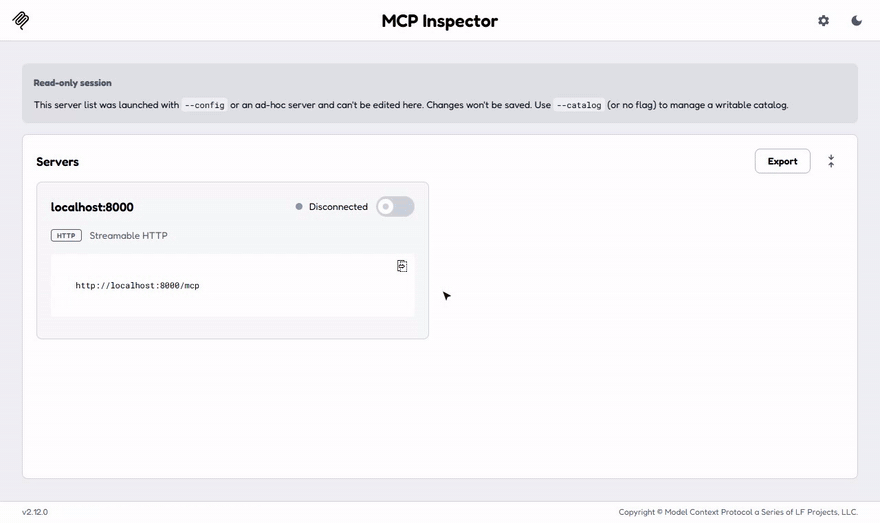
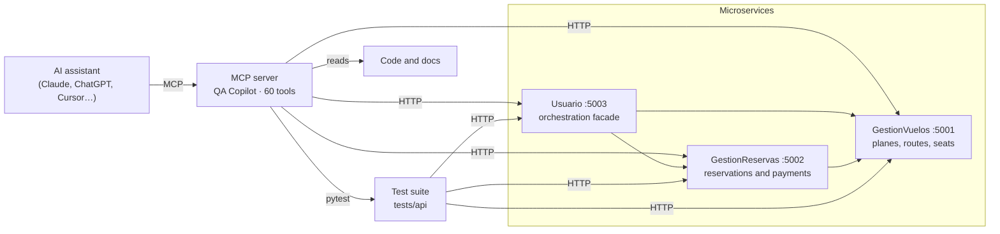

# FlightBooking QA Copilot

[](https://github.com/jmnzcn/flightbooking-qa-copilot-mcp/actions/workflows/tests.yml)


A flight booking system made of 3 microservices, a suite of 167 API tests I designed with the help
of a RAG assistant, and an MCP server that lets an AI assistant check the services, run the tests and
read the code, the way another QA on the team would.



<sub>The MCP server in [MCP Inspector](https://github.com/modelcontextprotocol/inspector), with the 3 microservices running in Docker: the Usuario service's health, real flight routes and a pytest run started from the MCP server itself (×1.4).</sub>

## Results

- 167 tests in 39 files, run against the real services in Docker on every push.
- 33 of the 34 functional requirements (97 %) have at least one automated test.
- No flaky tests: I ran all 167 twice and got identical results.
- Designing a test case took about 4.4 minutes with the RAG assistant, against about 6.4 minutes by
  hand from Swagger, roughly 30 % less.
- Of the assistant's 16 suggestions, I used 9 as they were, adjusted 6 to match how the services
  actually behave and threw away 1.
- The MCP server has 60 tools: 45 that call the 52 endpoints, 7 that run pytest and 8 that read code
  and documentation.

The raw numbers (design times, how each suggestion was classified, requirement coverage, flakiness
runs) are in [`metrics/`](metrics/).

### Bugs the tests found

The worst one was duplicate reservation IDs. `POST /add_reservation` assigned `len(reservations) + 1`,
so after deleting a reservation the next one reused an existing ID, and a second `DELETE` returned
200 instead of 404. My double-delete test first flagged it as a "business discrepancy"; once the
suite ran in CI it was clear it was a bug. It now uses `max(id) + 1` and has a regression test.

The end-to-end test also called `/usuario/cancel_payment_and_reservation` while the service exposes
`/cancel_payment_and_reservation`, which I fixed. And the `status` field only accepts `"Reservado"` or
`"Pagado"`, but the OpenAPI spec doesn't declare it as an enum. My first test tried 40 values and all
of them were rejected, so I rewrote it with real data.

## How it's built



There are 3 Flask microservices with 52 endpoints, validated with Marshmallow and documented with
Swagger at `/apidocs`. Usuario is a facade: customer actions like booking, paying and cancelling are
orchestrated against GestionVuelos and GestionReservas. Docker Compose starts all three with
gunicorn, and CI uses exactly that setup.

The MCP server, [`pf3866_mcp/server.py`](pf3866_mcp/server.py), is built with
[FastMCP](https://github.com/jlowin/fastmcp). With it you can ask an assistant something like "check
that all three services are up, run the payment tests, and if one fails, read the test and the
endpoint and tell me whether the problem is in the test or the backend". Tools include
`get_health`, `call_endpoint`, `usuario_add_reservation`, `run_all_api_tests`,
`run_api_tests_by_keyword` and `read_api_test_file`. Setup and example prompts are in
[`docs/MCP_TESTING.md`](docs/MCP_TESTING.md) and
[`docs/PROMPT_MCP_RAG_TESTER.md`](docs/PROMPT_MCP_RAG_TESTER.md).

## How the tests were designed

Each endpoint's documentation ([`docs/ENDPOINTS_*.md`](docs/)) and the OpenAPI spec are the RAG
assistant's knowledge base. For each endpoint I asked it for test cases (validation, integration
errors, happy paths) and recorded what I did with each suggestion in
[`metrics/rag_suggestions.csv`](metrics/rag_suggestions.csv). The cases became parametrized pytest
tests in `tests/api/test_*_rag.py`. Shared helpers look up valid data live (routes, free seats,
unpaid reservations) instead of relying on fixed IDs. Each of the 31 experiments is written up in
[`docs/EXPERIMENTO_RAG_*.md`](docs/) with the prompt, the suggestions and what I decided, and
[`tools/detect_flakiness.py`](tools/detect_flakiness.py) compares repeated runs.

Limits: the manual side of the time comparison is only 7 cases, measured by one person, so read it
as a hint and not a conclusion. The services keep their data in memory, so results depend on
starting from a clean state.

## Run it

You need Docker and Python 3.11+.

```bash
git clone https://github.com/jmnzcn/flightbooking-qa-copilot-mcp.git
cd flightbooking-qa-copilot-mcp
docker compose up -d --build          # the 3 microservices
pip install -r requirements-test.txt
pytest tests/api -q
```

Swagger for each service: http://localhost:5001/apidocs · http://localhost:5002/apidocs ·
http://localhost:5003/apidocs

To start the MCP server:

```bash
pip install "fastmcp>=2.10" requests pytest
python pf3866_mcp/server.py           # listens on http://localhost:8000/mcp (streamable HTTP)
```

<details>
<summary>Without Docker (Windows)</summary>

Start each service with `python app.py` inside its folder. On Windows use `127.0.0.1` instead of
`localhost` for the URLs between services and in the test variables (`GESTIONVUELOS_SERVICE`,
`GESTIONRESERVAS_SERVICE`, `GV_BASE_URL`, `GESTIONRESERVAS_BASE_URL`, `USUARIO_BASE_URL`). With
`localhost`, every request takes about 2 s longer because Windows tries IPv6 first, and the
end-to-end flow times out.
</details>

The folders are `GestionVuelos/`, `GestionReservas/` and `Usuario/` (the services), `pf3866_mcp/`
(the MCP server), `tests/api/` (the API tests), `tests/ai/` (the RAG client on ChromaDB), `docs/`,
`metrics/`, `tools/` and `openapi/`.

## Background

A lab for PF-3866 Software Testing, in the graduate program in Computer Science at the University of
Costa Rica.

## Resumen en español

Un sistema de reservas de vuelos con 3 microservicios Flask (52 endpoints), una suite de 167 pruebas
de API diseñada con ayuda de RAG y un servidor MCP con 60 herramientas para que un asistente de IA
consulte los servicios, corra las pruebas y lea el código. Cubre el 97 % de los requisitos, no tiene
pruebas inestables y encontró un bug real: IDs de reserva duplicados después de borrar una reserva.

## License

[PolyForm Noncommercial 1.0.0](LICENSE). You can read, run and modify it for noncommercial purposes,
including evaluating it for a job. Commercial use needs a license from me:
[neyfred@gmail.com](mailto:neyfred@gmail.com).

Ney Fred Jiménez Campos · [LinkedIn](https://www.linkedin.com/in/neyfred/) · [GitHub](https://github.com/jmnzcn)
