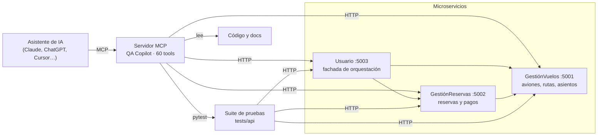

# ✈️ FlightBooking QA Copilot

**Un sistema de reservas de vuelos con 3 microservicios, una suite de 167 pruebas de API diseñada con ayuda de RAG y un servidor MCP que deja a un asistente de IA consultar los servicios, correr las pruebas y leer el código como un QA más del equipo.**

[](https://github.com/jmnzcn/flightbooking-qa-copilot-mcp/actions/workflows/tests.yml)


[English summary](#-english-summary) · [Resultados](#-resultados) · [Arquitectura](#-arquitectura) · [Servidor MCP](#-servidor-mcp-qa-copilot) · [Cómo correrlo](#-cómo-correrlo)

---

## 📊 Resultados

| | |
|---|---|
| **Pruebas de API** | 167 tests en 39 archivos, contra los servicios reales en Docker; corren en GitHub Actions en cada push |
| **Cobertura de requisitos** | 33 de 34 requisitos funcionales con al menos un test automatizado (97 %) |
| **Estabilidad** | 0 tests flaky: 167 tests corridos dos veces con resultados idénticos |
| **Diseño asistido por RAG** | ~4,4 min por caso de prueba, contra ~6,4 min diseñándolos a mano en Swagger (~30 % menos) |
| **Calidad de las sugerencias del RAG** | 16 sugerencias: 9 usadas tal cual, 6 ajustadas a la implementación real y 1 descartada |
| **Servidor MCP** | 60 tools: 45 para llamar a los 52 endpoints, 7 para correr pytest y 8 para leer código y documentación |

### 🐞 Bugs que encontró la suite

- **IDs de reserva duplicados.** `POST /add_reservation` asignaba `len(reservations) + 1`; después de borrar una reserva, la siguiente repetía un ID existente y un segundo `DELETE` devolvía 200 en vez de 404. La prueba de doble DELETE lo marcaba como "discrepancia de negocio"; al llevar la suite al CI quedó claro que era este bug. **Corregido** (`max(id) + 1`) y con test de regresión.
- **Ruta equivocada en el flujo E2E.** El test end-to-end llamaba a `/usuario/cancel_payment_and_reservation`, pero el servicio la expone como `/cancel_payment_and_reservation`. **Corregido.**
- **Schema no documentado.** El campo `status` solo acepta `"Reservado"` o `"Pagado"`, pero el spec OpenAPI no lo expone como enum; el primer test probaba 40 valores y todos eran rechazados. Se rehízo con datos reales.

Métricas crudas en [`metrics/`](metrics/): tiempos de diseño, clasificación de sugerencias, cobertura de requisitos y corridas de flakiness.

---

## 🧩 Arquitectura



- **3 microservicios Flask** con 52 endpoints, validación con Marshmallow y documentación Swagger/OpenAPI en `/apidocs`.
- **Usuario** es una fachada: las operaciones de "usuario final" (reservar, pagar, cancelar) se orquestan contra GestiónVuelos y GestiónReservas.
- **Docker Compose** levanta los tres con gunicorn; el CI usa exactamente esa configuración.

---

## 🤖 Servidor MCP (QA Copilot)

[`pf3866_mcp/server.py`](pf3866_mcp/server.py) usa [FastMCP](https://github.com/jlowin/fastmcp) y expone el sistema a cualquier cliente MCP. Con él, un asistente puede, por ejemplo:

> *"Revisa la salud de los tres servicios, corre los tests de pagos y, si alguno falla, lee el test y el endpoint y dime si el problema está en la prueba o en el backend."*

| Grupo | Tools | Ejemplos |
|---|---:|---|
| Llamadas a los servicios | 45 | `get_health`, `call_endpoint`, `usuario_add_reservation`, `create_payment_reservas` |
| Ejecución de pruebas | 7 | `run_all_api_tests`, `run_api_test_file`, `run_api_tests_by_keyword`, `run_single_api_test` |
| Lectura de código y docs | 8 | `read_api_test_file`, `read_repo_file`, `list_experimento_docs`, `read_all_md_docs` |

Cómo conectarlo y ejemplos de prompts: [`docs/MCP_TESTING.md`](docs/MCP_TESTING.md) y [`docs/PROMPT_MCP_RAG_TESTER.md`](docs/PROMPT_MCP_RAG_TESTER.md).

---

## 🧪 Cómo se diseñaron las pruebas

1. **Contexto:** la documentación de cada endpoint ([`docs/ENDPOINTS_*.md`](docs/)) y el spec OpenAPI se usan como base de conocimiento.
2. **Sugerencias con RAG:** para cada endpoint se piden casos de prueba (validaciones, errores de integración, casos felices). Cada sugerencia se clasifica: usada tal cual, ajustada o descartada ([`metrics/rag_suggestions.csv`](metrics/rag_suggestions.csv)).
3. **Implementación en pytest:** los casos quedan como tests parametrizados en `tests/api/test_*_rag.py`, con helpers compartidos que buscan datos válidos en vivo (rutas, asientos libres, reservas sin pago) en lugar de IDs fijos.
4. **Registro de cada experimento:** 31 experimentos documentados en [`docs/EXPERIMENTO_RAG_*.md`](docs/), con el prompt, las sugerencias y las decisiones tomadas.
5. **Métricas:** tiempo de diseño por caso, cobertura de requisitos y flakiness (dos corridas comparadas con [`tools/detect_flakiness.py`](tools/detect_flakiness.py)).

**Limitaciones:** la comparación de tiempos manual vs. RAG tiene pocas muestras del lado manual (7 casos) y la midió una sola persona; tómala como indicio, no como conclusión. Los servicios guardan los datos en memoria, así que los resultados dependen de arrancar con estado limpio.

---

## 🚀 Cómo correrlo

Requisitos: Docker y Python 3.11+.

```bash
git clone https://github.com/jmnzcn/flightbooking-qa-copilot-mcp.git
cd flightbooking-qa-copilot-mcp

# 1) Levantar los 3 microservicios
docker compose up -d --build

# 2) Correr las pruebas de API
pip install -r requirements-test.txt
pytest tests/api -q
```

Swagger de cada servicio: http://localhost:5001/apidocs · http://localhost:5002/apidocs · http://localhost:5003/apidocs

<details>
<summary>Levantar el servidor MCP</summary>

```bash
pip install fastmcp requests pytest
python pf3866_mcp/server.py
```

Queda escuchando en `http://localhost:8000/mcp` (transporte streamable HTTP). Configúralo en tu cliente MCP con esa URL.
</details>

<details>
<summary>Sin Docker (Windows)</summary>

Arranca cada servicio con `python app.py` dentro de su carpeta. En Windows usa `127.0.0.1` en lugar de `localhost` para las URLs entre servicios y en las variables de los tests (`GESTIONVUELOS_SERVICE`, `GESTIONRESERVAS_SERVICE`, `GV_BASE_URL`, `GESTIONRESERVAS_BASE_URL`, `USUARIO_BASE_URL`): con `localhost`, cada petición tarda ~2 s extra porque Windows intenta IPv6 primero, y el flujo E2E llega al timeout.
</details>

<details>
<summary>Estructura del repositorio</summary>

```text
GestionVuelos/      microservicio de aviones, rutas y asientos (Flask)
GestionReservas/    microservicio de reservas y pagos (Flask)
Usuario/            fachada de orquestación (Flask)
pf3866_mcp/         servidor MCP (FastMCP) y simulador del agente RAG tester
tests/api/          pruebas de API (pytest + requests)
tests/ai/           cliente RAG (ChromaDB), generadores, contratos y triage de logs
docs/               endpoints, experimentos RAG y guías de uso del MCP
metrics/            reportes JUnit y CSV de métricas
tools/              scripts de métricas, KPIs y flakiness
openapi/            specs OpenAPI
```
</details>

---

## 🇺🇸 English summary

A flight-booking system built as **3 Flask microservices** (52 endpoints, Swagger/OpenAPI, Docker Compose), tested by a **167-test API suite** designed with a RAG-assisted workflow, plus an **MCP server with 60 tools** that lets an AI assistant call the services, run pytest and read the code and docs, acting as a QA copilot.

- **CI on every push:** GitHub Actions starts the services with Docker Compose and runs the full suite against them.
- **97 % requirements coverage** (33/34) and **0 flaky tests** across repeated runs.
- **RAG-assisted test design** took ~4.4 min per case vs. ~6.4 min for manual design in Swagger; 15 of 16 suggestions were usable (9 as-is, 6 adapted).
- **Found and fixed a real bug:** new reservations reused an existing ID after a delete, so a second DELETE returned 200 instead of 404. Fixed and covered by a regression test.

---

## 🎓 Contexto académico

Laboratorio del curso PF-3866 Pruebas de Software, Posgrado en Computación e Informática, Universidad de Costa Rica.

---

**Ney Fred Jiménez Campos** · [LinkedIn](https://www.linkedin.com/in/neyfred/) · [GitHub](https://github.com/jmnzcn) · neyfred@gmail.com
